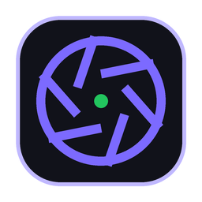

<div align="center">
  
  <h1>PixelPress Desktop Pro - Internal Architecture Guide</h1>
  <p><strong>High-Performance, On-Device Image Compression Workstation for Windows 11 and 10</strong><br>
  Built with Python 3.13, PyWebView (WebView2 Evergreen), Flask, and Pillow (LibJPEG-Turbo, LibPNG, LibWebP, LittleCMS)</p>
</div>

---

## Technical Highlights & Architecture

* **Cryptographic Token Gatekeeper:** All non-static Flask routes are guarded by a cryptographically secure session token (`X-PixelPress-Token`), completely mitigating localhost DNS rebinding and CSRF attacks from external browser tabs.
* **Native Desktop Window:** Powered by `pywebview` utilizing the native Windows Edge WebView2 runtime with Win32 modal dialog ownership. Zero browser popups, tabs, or devtools artifacts in production.
* **Ultra-Lightweight Footprint:** Single portable `.exe` is ~29.1 MB with ~22.7 MB installer package (compared to 180 MB+ for Electron apps).
* **Automated Engineering Test Harness:** 30 passing automated Pytest tests across security, compression, storage, and UI regression with continuous integration matrix.
* **100% Offline Resilience:** Bundled Lucide vector SVG icons, local font stack, zero cloud dependencies, and zero analytics telemetry.
* **Deep Pixel Inspection Engine:** Interactive Before / After Dual-Mode modal supporting both Side-by-Side and Split Slider views with 25% to 400% zoom peeping, 1:1 actual pixels, 2x artifact peeping, and synchronous pan.
* **Multi-Format Color & Animation Engine:**
  * Multi-frame Animated GIF and Animated WebP retention (duration, frame counts, loop settings).
  * LittleCMS perceptual CMYK-to-sRGB conversion preventing neon/inverted color shifts.
  * Embedded ICC Color Profile (`icc_profile`) extraction and preservation on JPEG, PNG, and WebP outputs.
  * 250 Megapixel (`DecompressionBombError`) defensive ceiling.
* **Dynamic Multi-Core Concurrency:** Hardware-scaled `ThreadPoolExecutor` up to 16 cores with Pillow releasing Python GIL during C-level encoding.
* **Zero-Leak Memory Lifecycle:** Client-side `activeObjectUrls` registry systematically revokes blob URLs via `URL.revokeObjectURL()` on queue re-renders, removals, and resets.
* **Settings Persistence:** Full automatic synchronization with `localStorage` for quality, format, resize dimensions, and compression options.
* **Smart Dual-Mode Storage:** Routes operational files to `%LOCALAPPDATA%\PixelPress\` by default (zero desktop clutter) or `PixelPress_Data\` when running in true USB portable mode (`.portable` marker).

---

## Project Structure

```
PixelPress-Desktop/
|
+-- app.py                      # Multi-threaded Flask backend, token gatekeeper & Pillow engine
+-- launcher.py                 # Desktop entry point with session token generation & WebView2 host
+-- PixelPress.spec             # PyInstaller spec for Directory Bundle (Inno Setup)
+-- PixelPress-Portable.spec    # PyInstaller spec for Single-File Standalone EXE
+-- build.bat                   # Automated compilation pipeline
+-- installer.iss               # Inno Setup 6 installer script
+-- requirements-desktop.txt    # Desktop build dependencies (pinned versions)
+-- requirements.txt            # Local development dependencies
+-- generate_icon.py            # Multi-size .ico generator
+-- icon.ico                    # Application icon
+-- README.md                   # Official Repository Documentation & Benchmarks
+-- README_DESKTOP.md           # Internal Architecture Guide
+-- plan.md                     # Master Re-Engineering Plan
+-- phases.md                   # Phased Roadmap & Decision Gates
+-- tasks.md                    # Atomic Task Checklist
+-- tracker.md                  # Real-Time Progress Dashboard
|
+-- .github/
|   +-- workflows/
|       +-- ci.yml              # Windows matrix automated CI workflow (Python 3.11, 3.12, 3.13)
|
+-- tests/
|   +-- conftest.py             # Pytest fixtures, test client & synthetic test images
|   +-- test_security.py        # Security & token gatekeeper test suite
|   +-- test_compression.py     # Multi-format compression, animation & color test suite
|   +-- test_storage.py         # LocalAppData vs portable storage & cleanup test suite
|   +-- test_phase1.py          # Phase 1 verification suite
|   +-- test_phase2.py          # Phase 2 verification suite
|   +-- test_phase3.py          # Phase 3 UI/UX & zoom verification suite
|
+-- docs/                       # GitHub Pages Official Showcase Website
|   +-- index.html              # Semantic HTML structure
|   +-- css/style.css           # Modular Dark Studio stylesheet
|   +-- js/main.js              # Split slider & savings calculator
|
+-- templates/
|   +-- index.html              # Desktop UI with embedded Lucide SVG sprite & zoom toolbar
|
+-- static/
    +-- css/style.css           # Desktop dark studio styling & WCAG AA contrast
    +-- js/main.js              # ZoomPanEngine, zero-leak Object URLs & settings persistence
```

---

## Automated Test Suite

Run the full pytest test suite:
```powershell
pytest -v tests/
```

Run specific phase verification scripts:
```powershell
python tests/test_phase1.py
python tests/test_phase2.py
python tests/test_phase3.py
```

---

## How to Build (Dual Pipeline)

Run the automated compilation script:
```bat
build.bat
```

Interactive selection menu:
```
[1] Portable Standalone EXE (Single-file dist/PixelPress-Portable.exe)
[2] Fast Directory Bundle + Inno Setup Installer (dist/PixelPress_Setup.exe)
[3] Build Both Targets
[4] Exit
```
